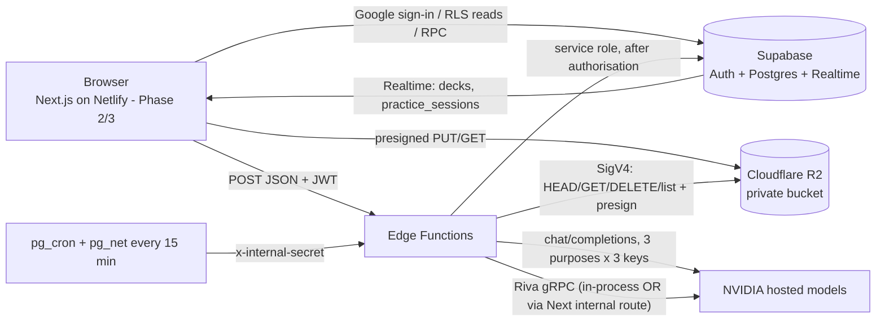
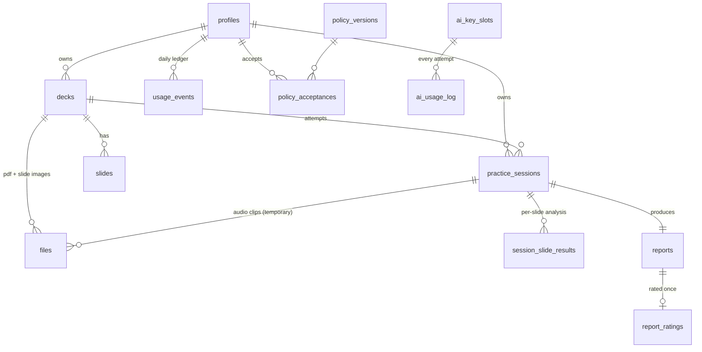
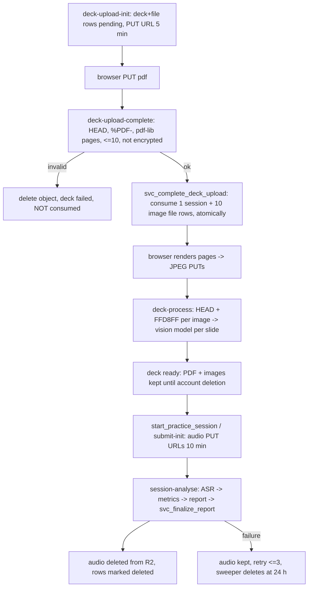

# Architecture

## System

No Express/Prisma/API server. The only server-side code besides Edge Functions is the optional Next.js route `app/api/internal/transcribe` (gRPC bridge, secret-protected).

## Entities

## Roles and permissions (enforced in SQL, not UI)
See `supabase.md` for the full policy table. In short: students read only their own rows; `anon` reads only `policy_versions`; the admin has **no** policy on student content tables and reads summaries only through `SECURITY DEFINER` RPCs; the admin cannot practise (D4); `role`, `is_blocked`, `email` can only change via service role or an admin RPC.

## File lifecycle

## AI pipelines (resumable, idempotent)
- **Deck processing** `awaiting_images → processing → ready | failed(ai_unavailable|processing_failed)`. Slides are upserted per `(deck, slide_index)`; re-running skips finished slides. 3 slides in parallel. Heartbeat = `decks.updated_at`.
- **Session analysis** `in_progress → uploading_audio → transcribing → generating_report → completed | failed`. Transcripts are stored per slide as they finish, so a retry/resume never re-transcribes. Heartbeat = `practice_sessions.updated_at`. A sweeper resumes anything quiet for > 5 min, up to 3 attempts.
- **Key routing** (per purpose; same model on all 3 keys): primary → fallback_1 → fallback_2, skipping slots in cooldown, at the soft RPM limit or out of credits. 429 → cooldown from `Retry-After` (default 60 s) and immediate fall-through; 5xx/timeout → 30 s; 401/403 → 10 min and flagged; 400/422 → no rotation. Everything is logged to `ai_usage_log`.

## Scoring (version `v1`)
`overall = round(0.35·coverage + 0.25·clarity + 0.20·timing + 0.20·fillers)`; WPM is informational only.
- coverage = round(100·covered/total) over all key points; unrecorded slides count as missed.
- clarity = model score clamped 0–100.
- timing: `d=|actual−target|/target`; 100 if d ≤ 0.05, linear to 0 at d ≥ 0.50.
- fillers: `fpm = fillers / max(minutes, 0.5)`; `clamp(round(100 − 15·fpm), 0, 100)`.
Constants live in `supabase/functions/_shared/constants.ts`; the pure maths in `scoring.ts`.

## Limits
10 slides · 5 MB PDF · 1–20 min · 5 sessions/day (IST) · 20 MB audio per clip · one in-flight deck per user · one analysing session per user.

## Decisions and why
| # | Decision | Reason / note |
|---|---|---|
| D1–D3 | Supabase + Google-only + owner by server-side email allowlist | no client-controlled role; allowlist never in a committed migration |
| D4 | admin cannot practise | `assert_can_practise` raises `is_admin`; tested for every practice entry point |
| D6/D7 | JPEG per slide + vision model | one call per slide returns title, text, key points, script, weight |
| D8 | server-side ASR only | server trusts its own duration from the WAV data chunk |
| D9 | 3 purposes × 3 keys | overflow handled by `routeCall` (unit-tested with a fake transport) |
| D11 | limit counted at validated upload and at every retake | atomic with an advisory lock; verified with 8 concurrent connections |
| D12/D13 | PDF + images kept, audio temporary | audio deleted only after R2 confirms; rows marked deleted afterwards |
| D15 | policy gate never interrupts an active session | submit/analyse skip the policy check; start/upload/rate enforce it |
| – | attempt numbers are unique among **non-abandoned** sessions | restarting an unsubmitted attempt re-uses its number and is not charged twice |
| – | `profiles` edited by direct UPDATE (column grants + RLS + guard trigger) | no profile RPC; defence in depth against `role`/`is_blocked`/`email` changes |
